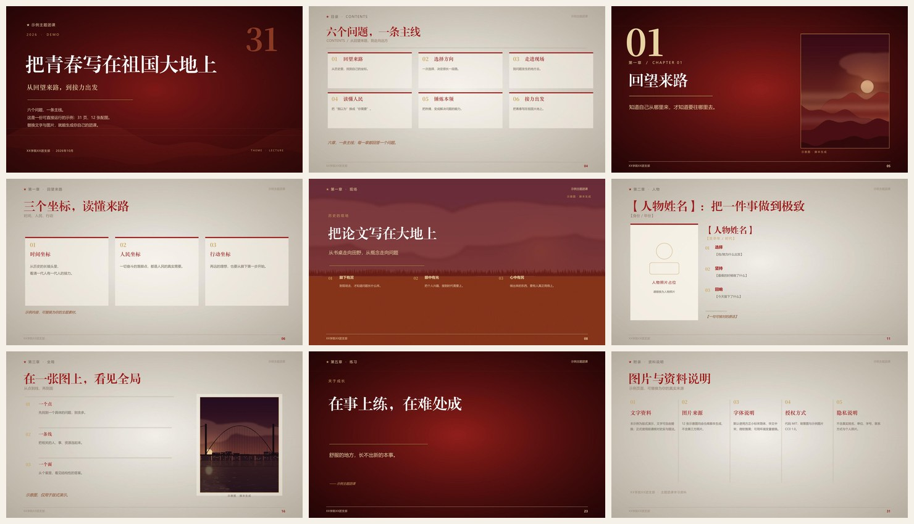

# 红金团课 PPT 生成器

> 配置驱动的红金党政风团课 / 党课 PPT 生产线：一份 Python 配置，同时生成 **16:9 PPTX** 和 **逐页可照读的 Word 讲稿**。

[](https://www.python.org/)
[](LICENSE)




## 这是什么

一套可复用的「红金党政风」版式引擎，也是一个 **Agent Skill**：

- **统一视觉**：深红封面、宣纸内容页、金色线条、宋体标题；
- **统一结构**：封面 → 序章 → 六/八章 → 结语 → 来源；
- **统一讲稿**：每页 150—250 字，与 PPT 页码一一对应，可照读；
- **配置驱动**：页面是数据，不是手工排版；改文字、换图片即可复用；
- **可质检**：生成后渲染成图，按清单逐页检查压字、溢出、裁切。

适合：主题团课、党课、纪念周年、主题团日、支部汇报、培训课件。

> 本仓库只提供**版式与工具**，不附带任何第三方历史照片、人物肖像或字体。示例为 31 页、12 张配图，图片全部由脚本生成（CC0），文字为演示内容。

## 快速开始

```bash
git clone https://github.com/IceofTea/red-gold-league-ppt.git
cd red-gold-league-ppt
python -m pip install -e .
python examples/demo.py
```

生成结果在 `out/demo/`：

```text
out/demo/
├── demo_主题团课.pptx
└── demo_演讲稿.docx
```

也可以直接用 CLI：

```bash
red-gold-deck validate examples/demo.py
red-gold-deck build examples/demo.py
red-gold-deck build examples/demo.py -o ./out
```

## 作为 Agent Skill 使用

把仓库克隆到 Agent 的 skills 目录，`SKILL.md` 会被自动识别：

```bash
# OpenCode
git clone https://github.com/IceofTea/red-gold-league-ppt.git \
  ~/.config/opencode/skills/red-gold-league-ppt

# Claude Code（如使用）
git clone https://github.com/IceofTea/red-gold-league-ppt.git \
  ~/.claude/skills/red-gold-league-ppt
```

然后对 Agent 说：

> 用 red-gold-league-ppt 这个 skill，做一堂《……》主题团课，50 页左右，要有时间轴、人物页和逐页讲稿。

Agent 会读取 `SKILL.md` → `docs/PAGES.md` → `examples/demo.py`，复制配置、替换内容、生成并渲染检查。

## 页面类型

| 类型 | 用途 | 关键字段 |
|---|---|---|
| `cover` | 封面 | `kicker` `years` `title` `subtitle` `lead` `big` |
| `quote` | 序章 / 金句 / 小结 | `chapter` `small` `big` `sub` `note` |
| `stats` | 一组数字 | `numbers`（2—5 组） |
| `toc` / `toc6` / `toc8` | 目录（3—8 章） | `items` |
| `chapter` | 章节页 | `num` `cn` `title` `quote` `img` |
| `content` | 2—4 卡内容页 | `cards` `lead` `note` |
| `timeline` | 3—6 节点时间轴 | `events` |
| `person` | 人物页（3 件事 + 原话） | `name` `dates` `deeds` `quote` `img` |
| `two_col` | 左右对照 | `left_items` `right_items` |
| `fullpic` | 整版历史照片 | `img` `points` `caption` |
| `map_page` | 左文右图（地图/竖图） | `img` `points` `footnote` |
| `listpage` | 3—6 条清单 | `items` |
| `closing` | 结语 | `lines` `slogan` |
| `thanks` | 致谢 | `title` `sub` |
| `sources` | 来源 / 版权说明 | `items` `credit` |

完整字段、数量限制与示例见 **[docs/PAGES.md](docs/PAGES.md)**。

## 一份最小配置

```python
from red_gold_deck import build

CFG = {
    "footer": "XX学院XX团支部",
    "header": "示例主题团课",
    "topic": "把青春写在祖国大地上",
    "out_dir": "out",
    "folder": "demo",
    "ppt": "demo.pptx",
    "doc": "demo.docx",
    "expect_pages": 4,
    "pages": [
        {"t": "cover", "kicker": "★ 主题团课", "years": "2026",
         "title": "把青春写在祖国大地上", "subtitle": "副标题",
         "lead": "两行导语", "big": "4", "script": "封面讲稿……"},
        {"t": "quote", "chapter": "序章", "small": "小标题",
         "big": "一句金句", "sub": "一句解释", "script": "讲稿……"},
        {"t": "content", "chapter": "第一章", "title": "三张卡片",
         "sub": "副标题",
         "cards": [("一", "内容"), ("二", "内容"), ("三", "内容")],
         "script": "讲稿……"},
        {"t": "thanks", "title": "感谢聆听", "sub": "副标题",
         "script": "讲稿……"},
    ],
}

build(CFG)
```

## 项目结构

```text
red-gold-league-ppt/
├── SKILL.md                 # Agent Skill 入口
├── red_gold_deck/
│   ├── builder.py           # 配置校验 + 页面分发 + 生成 DOCX
│   ├── deck.py              # 基础版式（封面/章节/内容/时间轴/数据/金句…）
│   ├── rich.py              # 丰富版式（目录/人物/全图/地图/清单）
│   ├── helpers.py           # 颜色、字体、文本框、图片裁切
│   ├── docx_util.py         # Word 讲稿
│   └── assets/bg/           # 4 张 CC0 背景（脚本生成）
├── examples/
│   ├── demo.py              # 可运行的 31 页示例配置
│   └── assets/              # 示例图片（CC0，脚本生成）
├── scripts/
│   ├── make_backgrounds.py  # 重新生成背景
│   ├── make_demo_assets.py  # 重新生成示例图片
│   ├── fetch_images.py      # 按关键词抓取候选图（需自行审查版权）
│   ├── check_deck.py        # 页数/图片/越界检查
│   ├── render.ps1           # Windows：PowerPoint + pdftoppm
│   └── render.sh            # macOS/Linux：LibreOffice + pdftoppm
├── docs/
│   ├── PAGES.md             # 页面类型手册
│   ├── DESIGN.md            # 视觉规范与质检清单
│   ├── ASSETS.md            # 配图、肖像、版权与隐私
│   ├── TROUBLESHOOTING.md   # 常见问题
│   └── ci.yml               # GitHub Actions 配置样例
└── tests/                   # pytest
```

### 启用 CI

`docs/ci.yml` 是一份可直接使用的 GitHub Actions 配置（Python 3.10—3.13，跑 pytest 并生成示例）。复制到 `.github/workflows/ci.yml` 后提交即可：

```bash
mkdir -p .github/workflows
cp docs/ci.yml .github/workflows/ci.yml
git add .github/workflows/ci.yml
git commit -m "ci: enable tests"
git push
```

如果你的 GitHub 账号使用 OAuth App 令牌推送，可能会因为没有 `workflow` 权限而被拒绝；用网页端创建该文件，或改用带 `workflow` 权限的令牌即可。

## 字体

默认字体栈面向 Windows 中文办公环境：

| 用途 | 默认字体 | 环境变量 |
|---|---|---|
| 标题 | 方正小标宋简体 | `RED_GOLD_TITLE_FONT` |
| 衬线标题 | 华文中宋 | `RED_GOLD_SERIF_FONT` |
| 正文 | 微软雅黑 | `RED_GOLD_BODY_FONT` |
| 数字 | Noto Serif SC | `RED_GOLD_NUM_FONT` |

这些字体**不随仓库分发**。没有安装时，PowerPoint 会回退到系统字体，版式可能变化。macOS/Linux 可换成思源宋体 / Noto Serif CJK / 苹方等：

```bash
export RED_GOLD_TITLE_FONT="Source Han Serif SC"
export RED_GOLD_BODY_FONT="Source Han Sans SC"
export RED_GOLD_NUM_FONT="Source Han Serif SC"
```

## 渲染检查

生成 PPTX 不等于完成。必须渲染成图逐页目检。

**Windows（PowerPoint）**

```powershell
powershell -ExecutionPolicy Bypass -File scripts/render.ps1 `
  -Pptx out/demo/demo_主题团课.pptx -OutDir out/demo/render
```

**macOS / Linux（LibreOffice）**

```bash
bash scripts/render.sh out/demo/demo_主题团课.pptx out/demo/render
```

渲染后重点看：封面标题、目录卡片、内容页卡片、时间轴两端、人物页肖像、章节页/全图页裁切、来源页版权说明。清单见 **[docs/DESIGN.md](docs/DESIGN.md)**。

## 配图与版权

- 仓库**不包含**任何第三方照片、人物肖像或商业字体；
- `examples/assets/` 与 `red_gold_deck/assets/bg/` 均由脚本生成，CC0；
- 自己配图时，请逐张确认授权，并在 `sources` 页写清来源；
- 支部汇报不建议使用成员真人照片、真实姓名、学号、手机号；
- 抓图脚本只负责下载候选，**版权与合规审查由使用者负责**。

详见 **[docs/ASSETS.md](docs/ASSETS.md)**。

## 免责声明

本项目提供的是排版工具，不构成任何历史、政治或法律结论。使用者在填充内容时，应自行核对史实、引文、数据与官方提法，并遵守所在单位的宣传纪律。示例文字仅用于演示版式，不代表任何机构立场。

## License

- 代码：**MIT**（见 [LICENSE](LICENSE)）
- 背景图与示例图片：**CC0 1.0**
- 示例文字：仅用于演示，可自由替换

---

## English

A config-driven generator for red-and-gold Chinese lecture decks. One Python
config produces a 16:9 PPTX and a page-by-page Word script. It doubles as an
Agent Skill (`SKILL.md`) for OpenCode/Claude-style coding agents.

```bash
pip install -e .
python examples/demo.py
```

No third-party photos, portraits, or fonts are bundled. Backgrounds and demo
images are generated from scratch and released under CC0. Code is MIT.
